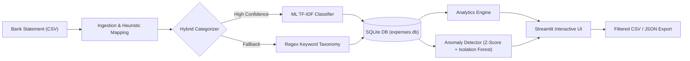

# Personal Expense Intelligence & Spending Analyzer (ExpenseIQ)

[](https://github.com/raguramrrp/90-days-90-projects-day-01-expense-analyzer)
[](#)
[](https://www.python.org/)
[](https://streamlit.io/)
[](https://www.sqlite.org/)
[](LICENSE)

> **Day 1 of the 90 Days – 90 Projects Challenge**  
> An autonomous, privacy-first personal expense intelligence engine that turns cryptic bank transaction logs into clean classifications, trend analytics, budget variances, and AI-detected spending anomalies.

---

## 1. Project Title & Description

**Personal Expense Intelligence & Spending Analyzer (ExpenseIQ)** is a production-grade, local-first analytics application designed to help individuals understand where their money actually goes.

Instead of manually editing spreadsheets or trusting third-party cloud apps with sensitive banking credentials, ExpenseIQ provides local bank statement ingestion, dual-layer hybrid categorization (rule-based regular expressions + Scikit-Learn TF-IDF machine learning), interactive financial intelligence dashboards, and statistical & machine learning outlier detection.

---

## 2. Problem Statement & Motivation

People record expenses or download monthly credit card/bank statements, but rarely understand their true spending patterns. 

- **Cryptic Statements:** Bank logs contain fragmented strings (e.g. `TST* TRADER JOE 4821`, `SQ *COFFEE SHOP`, `XFINITY COMCAST PHIL`) that prevent fast categorization.
- **Unnoticed Outliers & Leaks:** Sudden abnormal expenses or creeping subscription costs slip by without immediate notification.
- **Budget Disconnect:** Individuals set mental spending goals but lack dynamic variance tracking against actual monthly outlays.
- **Privacy Concerns:** Cloud-hosted budgeting platforms frequently require linking live bank credentials, monetizing user transaction habits.

**ExpenseIQ** bridges this gap with an entirely offline, privacy-first architecture running locally on SQLite, Pandas, and Streamlit.

---

## 3. Objectives & Intended Users

### Objectives
- Automate bank statement CSV ingestion and column normalization.
- Deliver instant categorization via a hybrid engine combining domain regex with a TF-IDF Logistic Regression text classifier.
- Calculate essential financial KPIs: Total Spend, Average Transaction Size, and Daily Burn Rate.
- Uncover irregular transactions using category-specific Z-scores and unsupervised Isolation Forest models.
- Track actual category spending against customizable monthly budgets with automated warning states.

### Intended Users
- **Students & Young Professionals:** Managing personal allowances and avoiding end-of-month budget shortfalls.
- **Freelancers & Solopreneurs:** Separating business vs personal expenses and auditing repetitive operational costs.
- **Privacy-Conscious Users:** Anyone wanting enterprise-grade financial analytics without sending financial statements to cloud servers.

---

## 4. Key Features

- **📥 Intelligent Statement Ingestion:** Upload any standard bank or card CSV statement. Automatically detects date, description, amount, and category headers.
- **🤖 Hybrid Categorization Engine:**
  - *Layer 1:* Machine Learning classification via `TfidfVectorizer` and `LogisticRegression` with confidence thresholding ($P \ge 0.35$).
  - *Layer 2:* Rule-based regex matching over 100 merchant stems across 12 standard categories.
  - *Layer 3:* Graceful fallback to `Miscellaneous`.
- **📊 Executive Financial Dashboard:** Real-time KPI summary cards, interactive monthly trend bar & scatter charts, category distribution donut charts, and 7-day moving averages.
- **🚨 AI-Powered Anomaly Inspector:** Dual-layer outlier detection:
  - *Category Z-Score / IQR Bounds:* Catches transactions exceeding category normal distributions (e.g. \$450 in Groceries vs \$40 historical average).
  - *Isolation Forest:* Multivariate pattern anomaly scoring across amount, day of month, day of week, and category ratios.
- **🎯 Dynamic Budget Variance:** Monitor monthly spending against user-defined budget caps with visual status badges:
  - `Within Budget` ($< 85\%$)
  - `Near Limit` ($85\% - 100\%$)
  - `Over Budget` ($> 100\%$)
- **📑 Transaction Ledger & Search:** Filter by date, amount slider, category, or anomaly status. Full-text search with instant CSV and JSON exports.
- **🚀 One-Click Sample Dataset:** Instant demonstration mode pre-loads 140 realistic transactions across 4 months.

---
---

## 5. Architecture Overview



See [docs/ARCHITECTURE.md](docs/ARCHITECTURE.md) for full technical specifications and component interaction flows.

---

## 6. Technology Stack

- **Frontend / Dashboard:** [Streamlit](https://streamlit.io/) (v1.35+)
- **Interactive Visualizations:** [Plotly Express & Graph Objects](https://plotly.com/python/)
- **Data Manipulation & Analytics:** [Pandas](https://pandas.pydata.org/), [NumPy](https://numpy.org/)
- **Machine Learning & Anomaly Detection:** [Scikit-Learn](https://scikit-learn.org/) (`TfidfVectorizer`, `LogisticRegression`, `IsolationForest`)
- **Persistence & Storage:** [SQLite 3](https://www.sqlite.org/) (zero-configuration, embedded relational engine)
- **Model Serialization:** [Joblib](https://joblib.readthedocs.io/)
- **Testing Framework:** [Pytest](https://docs.pytest.org/)
- **Automation / Scripts:** Windows Batch Scripts (`setup.bat`, `run.bat`, `test.bat`)

---

## 7. Project Directory Structure

```
90-days-90-projects-day-01-expense-analyzer/
├── README.md                      # Primary documentation & recruiter portfolio overview
├── QUICKSTART.md                  # Rapid setup and execution instructions
├── LICENSE                        # MIT License
├── .gitignore                     # Git exclusion rules (venv, db, caches, secrets)
├── .env.example                   # Environment variable template
├── requirements.txt               # Pinned Python package dependencies
├── pyproject.toml                 # Modern Python packaging configuration
├── setup.bat                      # One-click Windows setup script
├── run.bat                        # One-click Windows application launcher
├── test.bat                       # One-click automated pytest runner
├── DEMO_SCRIPT.md                 # 90-second portfolio video/interview walkthrough script
├── docs/
│   ├── PROJECT_OVERVIEW.md        # Problem statement, scope & MVP boundaries
│   ├── ARCHITECTURE.md            # Component architecture & Mermaid data flow diagrams
│   ├── USER_GUIDE.md              # In-depth application user manual
│   ├── DEVELOPMENT_NOTES.md       # Architectural decisions & engineering trade-offs
│   ├── TESTING.md                 # Test matrix, assertions, and verification checklist
│   └── TROUBLESHOOTING.md         # Diagnostic guide for common environment errors
├── data/
│   ├── README.md                  # Dataset origin, schema, categories & anomaly baseline
│   └── sample_expenses.csv        # 140 realistic transactions covering 4 months
├── models/
│   └── expense_classifier.joblib  # Serialized ML categorization model artifact
├── scripts/
│   ├── generate_sample_data.py    # Reproducible synthetic transaction generator
│   └── train_classifier.py        # ML training and evaluation script (accuracy & F1)
├── src/
│   ├── __init__.py                # Source package definition
│   ├── database.py                # SQLite schema, indexing, CRUD & budget tracking
│   ├── categorizer.py             # Hybrid Regex + TF-IDF ML categorization engine
│   ├── anomaly_detector.py        # Statistical Z-score & IsolationForest outlier detector
│   ├── analytics.py               # KPIs, MoM growth, burn rates & budget comparisons
│   └── app.py                     # Multi-view Streamlit dashboard application
├── tests/
│   ├── test_database.py           # SQLite schema, CRUD, indexing & budget tests
│   ├── test_categorizer.py        # Regex matching & ML inference unit tests
│   ├── test_analytics.py          # Financial metric & aggregation unit tests
│   ├── test_anomaly.py            # Z-score and Isolation Forest outlier tests
│   └── test_e2e.py                # End-to-end integration and data export tests
└── screenshots/                   # Application screenshots and demo captures
```

---

## 8. Prerequisites

- **Operating System:** Windows 10 or 11 (64-bit)
- **Python:** Python 3.10, 3.11, or 3.12 (Recommended: Python 3.12 64-bit)
- **Hardware:** Any standard modern PC (minimum 4GB RAM, 500MB free disk space)
- **Browser:** Chrome, Edge, Firefox, or Brave

---

## 9. Step-by-Step Windows Installation

### Option A: One-Click Automated Setup (Recommended)
1. Open Command Prompt or PowerShell in the project directory.
2. Run `setup.bat`:
   ```cmd
   setup.bat
   ```
   *The script automatically verifies Python, creates `.venv`, installs dependencies, initializes the database schema, generates `sample_expenses.csv`, and trains the baseline ML classifier.*

### Option B: Manual Setup
```powershell
# 1. Create virtual environment
py -3.12 -m venv .venv

# 2. Activate virtual environment
.\.venv\Scripts\Activate.ps1

# 3. Upgrade pip and install dependencies
pip install --upgrade pip
pip install -r requirements.txt

# 4. Copy environment configuration
copy .env.example .env

# 5. Initialize database and generate data
python -c "from src.database import init_db; init_db()"
python scripts/generate_sample_data.py
python scripts/train_classifier.py
```

---

## 10. Quick Start Commands

```cmd
:: Run automated test suite
test.bat

:: Launch the Streamlit dashboard
run.bat
```
Open **`http://localhost:8501`** in your browser.

---

## 11. Environment Variables

ExpenseIQ operates out of the box with zero required environment configuration. Optional overrides can be configured in `.env`:

```ini
# Path to SQLite database file (default is expenses.db in project root)
EXPENSE_DB_PATH=expenses.db

# Currency symbol for dashboard rendering
CURRENCY_SYMBOL=$

# Streamlit Server Configuration
STREAMLIT_SERVER_PORT=8501
STREAMLIT_SERVER_HEADLESS=true
```

---

## 12. Dataset & Benchmark Specifications

- **File:** `data/sample_expenses.csv`
- **Volume:** 140 realistic transactions spanning 4 months.
- **License:** CC0 Public Domain (Generated via `scripts/generate_sample_data.py`).
- **Anomalies Included:**
  - Emergency Auto Transmission Repair ($950.00 in `Transportation`)
  - Apple MacBook Pro M3 Screen Repair ($780.00 in `Shopping`)
  - Specialty ER Medical Co-insurance ($850.00 in `Healthcare`)
  - Luxury Fine Dining Gala Celebration ($420.00 in `Dining`)

---

## 13. Example Usage: Input vs Output

### 1. Ingestion Input (Raw Statement CSV)
```csv
date,description,amount,payment_method
2026-10-01,Avalon Bay Apartment Rent,1250.00,Bank Transfer
2026-10-03,Trader Joe's Supermarket,84.50,Card
2026-10-04,Starbucks Store 1402,6.75,Card
2026-10-08,Emergency Auto Transmission Repair,950.00,Card
```

### 2. Auto-Categorization & Intelligence Output
```
[INFO] Classifying transaction: "Avalon Bay Apartment Rent" -> Rent & Housing (Confidence: 0.95 via ML)
[INFO] Classifying transaction: "Trader Joe's Supermarket"   -> Groceries (Confidence: 0.90 via Rule)
[INFO] Classifying transaction: "Starbucks Store 1402"       -> Dining (Confidence: 0.90 via Rule)
[ALERT] Anomaly Detected: "Emergency Auto Transmission Repair" ($950.00)
        Severity: HIGH | Z-Score: 4.8 | Diagnostic: Amount is 4.8x higher than Transportation historical mean ($48.20).
```

---

## 14. Testing Instructions & Test Results

Run the complete test suite:
```cmd
test.bat
```
*(Direct pytest command: `.\.venv\Scripts\pytest -v`)*

### Test Status Summary
| Test Suite | Assertions | Status |
|------------|------------|:------:|
| `test_database.py` | Schema creation, CRUD, batch insert, filtering, indexing | **PASS** |
| `test_categorizer.py` | Regex patterns, ML inference, fallback behavior | **PASS** |
| `test_analytics.py` | KPIs, MoM growth, trends, budget variance, top merchants | **PASS** |
| `test_anomaly.py` | Statistical Z-score & Isolation Forest outlier detection | **PASS** |
| `test_e2e.py` | End-to-end pipeline (CSV -> DB -> Analytics -> Export) | **PASS** |

---

## 15. Known Limitations

1. **Single-User Architecture:** SQLite is optimized for local, single-user access; it does not support distributed multi-tenant authentication.
2. **Offline Banking Ingestion:** Uses standard CSV uploads rather than live Plaid/Finicity OAuth sync, avoiding paid enterprise API dependencies.
3. **English Description Bias:** Baseline NLP token patterns are tuned for standard English merchant descriptions.

---

## 16. Troubleshooting

- **Python not found:** Ensure Python 3.10–3.12 is installed and "Add to PATH" was enabled during installation.
- **Port 8501 in use:** Run `run.bat` or launch on an alternate port: `.\.venv\Scripts\streamlit run src/app.py --server.port=8502`.
- For detailed remedies, refer to [docs/TROUBLESHOOTING.md](docs/TROUBLESHOOTING.md).

---

## 17. Security & Privacy Considerations

- **100% Local Data Residency:** Financial records are stored exclusively in local SQLite database files on the host machine.
- **Zero Cloud Leakage:** No transaction payloads, merchant names, or bank memos are transmitted over the internet.
- **Exclusion from VCS:** Database files (`*.db`, `*.sqlite`) and local environment variables (`.env`) are strictly excluded in `.gitignore`.

---

## 18. Future Enhancements

- [ ] Multi-currency conversion with automatic daily exchange rates.
- [ ] OCR receipt scanning via local Tesseract or lightweight vision models.
- [ ] Automated recurring bill calendar forecasting based on past cycles.
- [ ] Optional encrypted SQLite backups (SQLCipher).

---

## 19. Learning Outcomes

- Mastery of **Pandas** for time-series resampling, rolling averages, grouping, and aggregations.
- Implementation of **hybrid NLP text classification** combining regex domain taxonomies with Scikit-learn TF-IDF pipelines.
- Real-world application of **unsupervised anomaly detection** (Z-Score + Isolation Forest) in personal financial time series.
- Construction of production-grade, responsive data analytics dashboards with **Streamlit** and **Plotly**.
- Robust software engineering practices: modular separation, automated testing, Windows batch automation, and comprehensive documentation.

---

## 20. License & Attribution

This project is licensed under the **MIT License** — see the [LICENSE](LICENSE) file for details.  
Developed by **Raguram** as Day 1 of the **90 Days – 90 Projects Challenge**.
