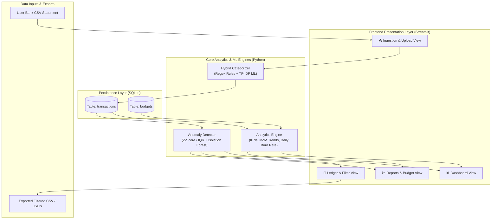

# System Architecture & Technical Specifications

This document outlines the architecture, data flow, component interactions, and storage schemas for the Personal Expense Intelligence platform.

---

## 1. High-Level Architecture Diagram

---

## 2. Component Breakdown

### 2.1 Persistence Layer (`src/database.py`)
- **Technology:** SQLite 3 with parameterized queries and thread-safe connections.
- **`transactions` Table:**
  - `id`: Integer Primary Key Autoincrement
  - `date`: ISO Date String (`YYYY-MM-DD`), indexed for time-range filtering.
  - `description`: Cleaned merchant text, indexed for full-text search.
  - `category`: Classification label (indexed for categorical aggregations).
  - `amount`: Float numerical currency value.
  - `payment_method`: Instrument used (`Card`, `Cash`, `UPI`, `Bank Transfer`, `Other`).
  - `notes`: User memo or auto-ingestion audit logs.
- **`budgets` Table:**
  - `category`: Text Primary Key.
  - `monthly_budget`: Float numerical ceiling in USD.

### 2.2 Hybrid Categorization Engine (`src/categorizer.py`)
1. **Rule-Based Engine:**
   - Compiled case-insensitive regular expressions matching over 100 merchant stems across 12 distinct categories.
   - Guaranteed determinism for well-known chains and utility providers.
2. **Machine Learning Model:**
   - **Vectorizer:** `TfidfVectorizer(ngram_range=(1, 2), min_df=1, sublinear_tf=True)`
   - **Classifier:** `LogisticRegression(max_iter=1000, C=10.0, class_weight='balanced')`
   - Confidence thresholding: If $P(\text{class} \mid \text{text}) \ge 0.35$, ML prediction is accepted; otherwise regex fallback activates.

### 2.3 Anomaly & Outlier Engine (`src/anomaly_detector.py`)
1. **Category Z-Score & IQR Bounds:**
   - Evaluates each transaction $x_i$ against its category historical mean $\mu_{\text{cat}}$ and standard deviation $\sigma_{\text{cat}}$:
     $$Z_i = \frac{x_i - \mu_{\text{cat}}}{\sigma_{\text{cat}}}$$
   - Outliers flagged when $Z_i \ge 2.0$ or $x_i > Q_3 + 1.5 \times \text{IQR}$.
2. **Unsupervised Isolation Forest:**
   - Multi-dimensional isolation tree ensemble analyzing amount, day-of-month, day-of-week, category frequency, and category mean ratio to capture multivariate behavioral anomalies.

### 2.4 Analytics Engine (`src/analytics.py`)
- **KPI Metrics:** Total spend, average transaction size, daily burn rate ($B = \text{Total} / \Delta t$), maximum single expense.
- **MoM Summary:** Groups by `YYYY-MM`, calculating $\Delta \$ = S_t - S_{t-1}$ and $\% = (S_t - S_{t-1}) / S_{t-1} \times 100$.
- **Budget Variance:** Computes variance $V = B_{\text{target}} - S_{\text{actual}}$ and budget utilization $U = (S_{\text{actual}} / B_{\text{target}}) \times 100\%$.
